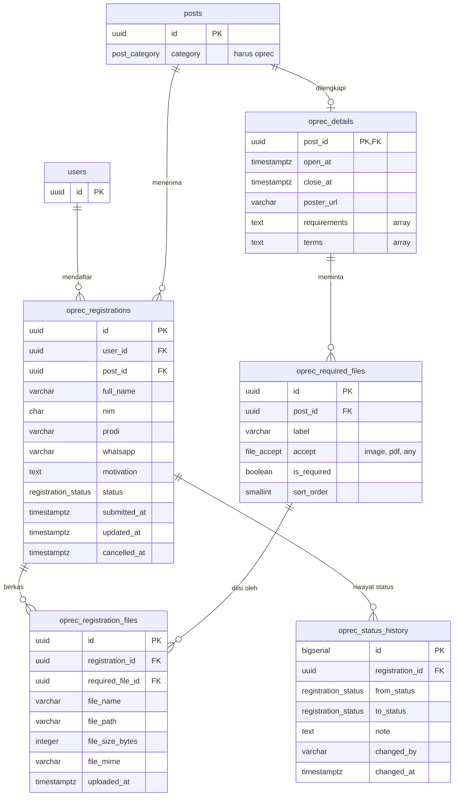

# UKM Hub Unand: ERD & API Contract (Seluruh Modul)

Nov 5, 2026 · diperbarui Nov 6, 2026 · @Lutfi

## Ringkasan

**Seluruh data aplikasi disimpan di PostgreSQL dan diakses lewat satu REST API buatan sendiri.** Dokumen ini adalah kontrak antara tiga pihak: aplikasi mobile Flutter, website admin, dan backend. Backend dibangun dengan Express; kontrak ini tidak bergantung pada framework tertentu.

| Pihak | Tugas | Bagian dokumen yang dipakai |
| --- | --- | --- |
| Aplikasi mobile (tim, tiga modul) | Mahasiswa melihat UKM dan feed, berinteraksi, mendaftar oprec, menerima notifikasi | Endpoint mobile (bagian API contract) |
| Website admin (kamu) | Pengurus UKM mengelola profil UKM, postingan, dan status pendaftaran | Endpoint admin |
| Backend (partnermu) | Database, REST API, penyimpanan berkas, pembuat notifikasi | Seluruh dokumen |

**Keputusan yang sudah diambil**

- Database: PostgreSQL dengan REST API buatan sendiri (opsi A). Tanpa Firebase.
- Notifikasi: foreground service di Android yang mengecek server berkala (polling), ditampilkan sebagai notifikasi lokal. Tanpa FCM.
- Satu jenis akun untuk semua pengguna. Hak mengelola UKM ditentukan oleh tabel kepengurusan `ukm_admins`, sesuai komentar di model `User` pada kode. Satu akun khusus (`is_superadmin`) boleh membuat UKM.
- Oprec (6 Nov 2026): pendaftar mengisi nomor WhatsApp di form; berkas yang diminta ditentukan admin per oprec sebagai slot (mis. Pas Foto, KTM, CV), satu berkas per slot; syarat pendaftaran dan syarat dan ketentuan disimpan sebagai daftar poin.

**Cakupan:** 16 tabel, 29 endpoint untuk aplikasi mobile, dan 15 endpoint untuk website admin. Spesifikasi detail Modul 3 (pendaftaran oprec) ada di dokumen Modul 3 Open Recruitment: API Contract & Database Design; bila ada perbedaan, dokumen ini yang berlaku.

**Prioritas** dipakai di tabel endpoint agar backend dibangun berurutan:

- **P1**: dibutuhkan alur demo utama (login, feed, detail, like, komentar, daftar oprec, status, notifikasi, dan sisi admin yang menyuplai datanya).
- **P2**: melengkapi kebutuhan PRD (follow, edit dan batal pendaftaran, like komentar).
- **P3**: pelengkap (laporan komentar, moderasi, unduh berkas).

## Desain database

Database punya 16 tabel. Agar terbaca, ERD dibagi tiga diagram menurut modul pemilik; kolom lengkap ada di DDL pada bagian berikutnya.

*(Diagram: ERD 1: autentikasi dan Modul 1 · 8 tabel. Lihat tabel dan DDL di bawahnya.)*

Diagram 1: satu UKM punya banyak postingan. Mahasiswa dan UKM terhubung lewat `follows` (mengikuti) dan `ukm_admins` (mengelola); `oprec_details` melengkapi postingan oprec.

*(Diagram: ERD 2: Modul 2 · 4 tabel + 2 rujukan. Lihat tabel dan DDL di bawahnya.)*

Diagram 2: komentar menghubungkan mahasiswa dan postingan, dan balasan menunjuk ke komentar lain. Like postingan dan like komentar punya tabel penghubung sendiri.

ERD 3: Modul 3 · 5 tabel + 2 rujukan. Tabel rujukan (`users`, `posts`) hanya ditulis kolom kuncinya.



Diagram 3: satu pendaftaran menghubungkan satu mahasiswa dengan satu postingan oprec, dan tiap perubahan statusnya tercatat di `oprec_status_history`. Admin menentukan slot berkas tiap oprec di `oprec_required_files`; tiap pendaftaran punya paling banyak satu berkas per slot di `oprec_registration_files`.

### Kepemilikan tabel

| Tabel | Modul | Ditulis oleh | Isi |
| --- | --- | --- | --- |
| users | Autentikasi | aplikasi mobile (daftar), seed | Akun mahasiswa dan pengurus |
| ukm | Modul 1 | website admin | Profil UKM |
| ukm_admins | Modul 1 | seed atau superadmin | Siapa mengelola UKM mana |
| follows | Modul 1 | aplikasi mobile | Mahasiswa mengikuti UKM |
| posts | Modul 1 | website admin | Postingan UKM (lima kategori) |
| post_attachments | Modul 1 | website admin | Lampiran gambar, video, dokumen |
| post_likes | Modul 2 | aplikasi mobile | Like pada postingan |
| comments | Modul 2 | aplikasi mobile | Komentar dan balasan |
| comment_likes | Modul 2 | aplikasi mobile | Like pada komentar |
| comment_reports | Modul 2 | aplikasi mobile, dibaca admin | Laporan komentar |
| oprec_details | Modul 3 | website admin | Periode, syarat, dan S&K oprec, satu baris per postingan oprec |
| oprec_required_files | Modul 3 | website admin | Slot berkas yang diminta tiap oprec |
| oprec_registrations | Modul 3 | aplikasi mobile, status oleh admin | Pendaftaran oprec |
| oprec_registration_files | Modul 3 | aplikasi mobile | Berkas pendaftaran, satu baris per slot yang diisi |
| oprec_status_history | Modul 3 | server | Riwayat perubahan status |
| notifications | Bersama | server | Notifikasi per pengguna |

### Aturan data penting

1. Kategori postingan: `event`, `lomba`, `prestasi`, `oprec`, `pengumuman` (PRD FR-05). Postingan `oprec` wajib punya satu baris `oprec_details`.
2. `like_count`, `comment_count`, dan `follower_count` dihitung dari tabelnya saat data dibaca, tidak disimpan sebagai kolom. Tambahkan kolom cache hanya bila terbukti lambat.
3. Komentar: `parent_id` menunjuk komentar induk (utas), `reply_to_id` menunjuk komentar yang dibalas langsung (untuk tampilan "@nama"). Menghapus komentar induk ikut menghapus semua balasannya; menghapus sebuah balasan hanya menghapus balasan itu.
4. Komentar dari pengurus UKM tampil atas nama UKM (`is_organizer`). Ini ditentukan saat dibaca dari `ukm_admins`, tidak disimpan di komentar.
5. Berkas (logo, banner, lampiran, berkas pendaftaran) disimpan di storage server; database hanya menyimpan nama, ukuran, tipe, dan URL atau path. Berkas pendaftaran disimpan satu baris per berkas di `oprec_registration_files`.
6. Semua id bertipe `uuid`, semua waktu `timestamptz` (UTC). Email disimpan huruf kecil dan unik.
7. Enum: `post_category`, `attachment_type` (image, video, document), `registration_status` (menunggu, seleksi, wawancara, diterima, ditolak, dibatalkan), `file_accept` (image, pdf, any: jenis berkas yang diterima satu slot oprec), `notification_type` (new_post, comment_reply, registration_status).

## DDL PostgreSQL

Jalankan berurutan dari atas ke bawah di PostgreSQL 13 ke atas (`gen_random_uuid()` sudah bawaan). Bila backend memakai migrasi framework (mis. Prisma), terjemahkan struktur yang sama. Empat aturan tidak bisa dijadikan constraint dan harus diperiksa di kode backend: postingan `oprec` wajib punya `oprec_details`; `oprec_registrations.post_id` harus menunjuk postingan berkategori `oprec`; `oprec_registration_files.required_file_id` harus slot milik oprec yang sama dengan pendaftarannya; dan `file_mime` harus sesuai `accept` slotnya.

```sql
CREATE TYPE post_category AS ENUM ('event','lomba','prestasi','oprec','pengumuman');
CREATE TYPE attachment_type AS ENUM ('image','video','document');
CREATE TYPE registration_status AS ENUM
  ('menunggu','seleksi','wawancara','diterima','ditolak','dibatalkan');
CREATE TYPE file_accept AS ENUM ('image','pdf','any');
CREATE TYPE notification_type AS ENUM ('new_post','comment_reply','registration_status');

-- Autentikasi
CREATE TABLE users (
  id            uuid PRIMARY KEY DEFAULT gen_random_uuid(),
  nim           char(10) NOT NULL UNIQUE CHECK (nim ~ '^[0-9]{10}$'),
  nama          varchar(100) NOT NULL,
  email         varchar(150) NOT NULL,
  no_hp         varchar(20) NOT NULL,
  password_hash varchar(255) NOT NULL,
  is_superadmin boolean NOT NULL DEFAULT false,
  created_at    timestamptz NOT NULL DEFAULT now(),
  updated_at    timestamptz NOT NULL DEFAULT now()
);
CREATE UNIQUE INDEX uq_users_email ON users (lower(email));

-- Modul 1: direktori dan feed
CREATE TABLE ukm (
  id          uuid PRIMARY KEY DEFAULT gen_random_uuid(),
  name        varchar(100) NOT NULL UNIQUE,
  description text NOT NULL,
  contact     varchar(255),
  logo_url    varchar(500),
  banner_url  varchar(500),
  is_verified boolean NOT NULL DEFAULT true,
  created_at  timestamptz NOT NULL DEFAULT now(),
  updated_at  timestamptz NOT NULL DEFAULT now()
);

CREATE TABLE ukm_admins (
  user_id    uuid NOT NULL REFERENCES users(id) ON DELETE CASCADE,
  ukm_id     uuid NOT NULL REFERENCES ukm(id) ON DELETE CASCADE,
  created_at timestamptz NOT NULL DEFAULT now(),
  PRIMARY KEY (user_id, ukm_id)
);

CREATE TABLE follows (
  user_id     uuid NOT NULL REFERENCES users(id) ON DELETE CASCADE,
  ukm_id      uuid NOT NULL REFERENCES ukm(id) ON DELETE CASCADE,
  followed_at timestamptz NOT NULL DEFAULT now(),
  PRIMARY KEY (user_id, ukm_id)
);
CREATE INDEX ix_follows_ukm ON follows (ukm_id);

CREATE TABLE posts (
  id           uuid PRIMARY KEY DEFAULT gen_random_uuid(),
  ukm_id       uuid NOT NULL REFERENCES ukm(id) ON DELETE CASCADE,
  created_by   uuid REFERENCES users(id) ON DELETE SET NULL,
  category     post_category NOT NULL,
  badge        varchar(50),
  title        varchar(200) NOT NULL,
  description  varchar(500) NOT NULL,
  content      text NOT NULL,
  location     varchar(150),
  tags         text[] NOT NULL DEFAULT '{}',
  banner_url   varchar(500),
  published_at timestamptz NOT NULL DEFAULT now(),
  created_at   timestamptz NOT NULL DEFAULT now(),
  updated_at   timestamptz NOT NULL DEFAULT now()
);
CREATE INDEX ix_posts_feed ON posts (published_at DESC);
CREATE INDEX ix_posts_ukm ON posts (ukm_id, published_at DESC);
CREATE INDEX ix_posts_category ON posts (category, published_at DESC);

CREATE TABLE post_attachments (
  id         uuid PRIMARY KEY DEFAULT gen_random_uuid(),
  post_id    uuid NOT NULL REFERENCES posts(id) ON DELETE CASCADE,
  type       attachment_type NOT NULL,
  name       varchar(255) NOT NULL,
  url        varchar(500) NOT NULL,
  size_bytes integer NOT NULL CHECK (size_bytes >= 0),
  created_at timestamptz NOT NULL DEFAULT now()
);
CREATE INDEX ix_attachments_post ON post_attachments (post_id);

-- Modul 2: interaksi sosial
CREATE TABLE post_likes (
  user_id    uuid NOT NULL REFERENCES users(id) ON DELETE CASCADE,
  post_id    uuid NOT NULL REFERENCES posts(id) ON DELETE CASCADE,
  created_at timestamptz NOT NULL DEFAULT now(),
  PRIMARY KEY (user_id, post_id)
);
CREATE INDEX ix_post_likes_post ON post_likes (post_id);

CREATE TABLE comments (
  id          uuid PRIMARY KEY DEFAULT gen_random_uuid(),
  post_id     uuid NOT NULL REFERENCES posts(id) ON DELETE CASCADE,
  user_id     uuid NOT NULL REFERENCES users(id) ON DELETE CASCADE,
  parent_id   uuid REFERENCES comments(id) ON DELETE CASCADE,
  reply_to_id uuid REFERENCES comments(id) ON DELETE SET NULL,
  content     text NOT NULL CHECK (char_length(content) BETWEEN 3 AND 1000),
  edited_at   timestamptz,
  created_at  timestamptz NOT NULL DEFAULT now()
);
CREATE INDEX ix_comments_post ON comments (post_id, created_at);
CREATE INDEX ix_comments_parent ON comments (parent_id);

CREATE TABLE comment_likes (
  user_id    uuid NOT NULL REFERENCES users(id) ON DELETE CASCADE,
  comment_id uuid NOT NULL REFERENCES comments(id) ON DELETE CASCADE,
  created_at timestamptz NOT NULL DEFAULT now(),
  PRIMARY KEY (user_id, comment_id)
);
CREATE INDEX ix_comment_likes_comment ON comment_likes (comment_id);

CREATE TABLE comment_reports (
  id          uuid PRIMARY KEY DEFAULT gen_random_uuid(),
  comment_id  uuid NOT NULL REFERENCES comments(id) ON DELETE CASCADE,
  reporter_id uuid NOT NULL REFERENCES users(id) ON DELETE CASCADE,
  reason      varchar(20) NOT NULL
              CHECK (reason IN ('spam','kasar','tidak_relevan','lainnya')),
  resolved_at timestamptz,
  created_at  timestamptz NOT NULL DEFAULT now(),
  UNIQUE (comment_id, reporter_id)
);

-- Modul 3: open recruitment
CREATE TABLE oprec_details (
  post_id      uuid PRIMARY KEY REFERENCES posts(id) ON DELETE CASCADE,
  open_at      timestamptz NOT NULL,
  close_at     timestamptz NOT NULL,
  poster_url   varchar(500),
  requirements text[] NOT NULL DEFAULT '{}',
  terms        text[] NOT NULL DEFAULT '{}',
  CHECK (close_at > open_at)
);

CREATE TABLE oprec_required_files (
  id          uuid PRIMARY KEY DEFAULT gen_random_uuid(),
  post_id     uuid NOT NULL REFERENCES oprec_details(post_id) ON DELETE CASCADE,
  label       varchar(100) NOT NULL,
  accept      file_accept NOT NULL,
  is_required boolean NOT NULL DEFAULT true,
  sort_order  smallint NOT NULL DEFAULT 0
);
CREATE INDEX ix_required_files_post ON oprec_required_files (post_id, sort_order);

CREATE TABLE oprec_registrations (
  id              uuid PRIMARY KEY DEFAULT gen_random_uuid(),
  user_id         uuid NOT NULL REFERENCES users(id),
  post_id         uuid NOT NULL REFERENCES posts(id),
  full_name       varchar(100) NOT NULL CHECK (char_length(full_name) >= 3),
  nim             char(10) NOT NULL CHECK (nim ~ '^[0-9]{10}$'),
  prodi           varchar(100) NOT NULL CHECK (char_length(prodi) >= 2),
  whatsapp        varchar(16) NOT NULL CHECK (whatsapp ~ '^(\+62|62|0)8[0-9]{8,11}$'),
  motivation      text NOT NULL CHECK (char_length(motivation) BETWEEN 20 AND 1000),
  status          registration_status NOT NULL DEFAULT 'menunggu',
  submitted_at    timestamptz NOT NULL DEFAULT now(),
  updated_at      timestamptz NOT NULL DEFAULT now(),
  cancelled_at    timestamptz
);
CREATE UNIQUE INDEX uq_active_registration
  ON oprec_registrations (user_id, post_id) WHERE status <> 'dibatalkan';
CREATE INDEX ix_registrations_user ON oprec_registrations (user_id, submitted_at DESC);
CREATE INDEX ix_registrations_post ON oprec_registrations (post_id, status);

CREATE TABLE oprec_registration_files (
  id               uuid PRIMARY KEY DEFAULT gen_random_uuid(),
  registration_id  uuid NOT NULL REFERENCES oprec_registrations(id) ON DELETE CASCADE,
  required_file_id uuid NOT NULL REFERENCES oprec_required_files(id),
  file_name        varchar(255) NOT NULL,
  file_path        varchar(500) NOT NULL,
  file_size_bytes  integer NOT NULL CHECK (file_size_bytes <= 2097152),
  file_mime        varchar(100) NOT NULL
                   CHECK (file_mime IN ('application/pdf','image/jpeg','image/png')),
  uploaded_at      timestamptz NOT NULL DEFAULT now(),
  UNIQUE (registration_id, required_file_id)
);

CREATE TABLE oprec_status_history (
  id              bigserial PRIMARY KEY,
  registration_id uuid NOT NULL REFERENCES oprec_registrations(id) ON DELETE CASCADE,
  from_status     registration_status,
  to_status       registration_status NOT NULL,
  note            text,
  changed_by      varchar(20) NOT NULL CHECK (changed_by IN ('mahasiswa','admin')),
  changed_at      timestamptz NOT NULL DEFAULT now()
);
CREATE INDEX ix_history_registration ON oprec_status_history (registration_id, changed_at);

-- Bersama: notifikasi
CREATE TABLE notifications (
  id         uuid PRIMARY KEY DEFAULT gen_random_uuid(),
  user_id    uuid NOT NULL REFERENCES users(id) ON DELETE CASCADE,
  type       notification_type NOT NULL,
  title      varchar(150) NOT NULL,
  body       varchar(300) NOT NULL,
  ref_id     uuid,
  post_id    uuid REFERENCES posts(id) ON DELETE CASCADE,
  is_read    boolean NOT NULL DEFAULT false,
  created_at timestamptz NOT NULL DEFAULT now()
);
CREATE INDEX ix_notifications_user ON notifications (user_id, created_at DESC);
CREATE INDEX ix_notifications_unread ON notifications (user_id) WHERE is_read = false;
```

## API contract: konvensi dan objek

Aplikasi mobile dan website admin memakai satu base URL, satu format respons, dan satu daftar kode error. Bagian ini mendefinisikannya, lalu bentuk objek yang dipakai bersama.

### Konvensi

| Hal | Aturan |
| --- | --- |
| Base URL | `https://<host>/api/v1` (host belum ditentukan) |
| Autentikasi | Header `Authorization: Bearer <token>` di semua endpoint kecuali `POST /auth/register` dan `POST /auth/login`. Token (JWT) berlaku 7 hari, tanpa refresh token (usulan) |
| Hak akses | Mahasiswa biasa: endpoint mobile. Pengurus UKM (ada di `ukm_admins`): endpoint `/admin/*` hanya untuk UKM yang ia kelola. Superadmin: semua UKM. Di luar itu server menjawab 403 |
| Format | JSON UTF-8, nama field snake_case. Endpoint yang membawa berkas memakai `multipart/form-data` |
| Waktu | ISO 8601 UTC, mis. `2026-11-05T05:12:00Z`; klien mengubahnya ke WIB saat ditampilkan |
| Respons sukses | `{"data": ..., "meta": {...}}`; `meta` hanya ada pada daftar: `page`, `limit`, `total` |
| Paginasi | `?page=1&limit=20` (bawaan 20, maksimal 50) |
| Respons error | `{"error": {"code": "...", "message": "...", "fields": {...}}}`. `message` berbahasa Indonesia dan aman ditampilkan langsung; `fields` hanya untuk 422 |
| Idempotensi | `PUT` dan `DELETE` untuk like dan follow aman dipanggil berulang; hasil akhir sama, kode tetap 200 |
| Berkas | URL berkas publik berupa URL lengkap (logo, banner, lampiran, poster). Berkas pendaftaran tidak publik dan hanya lewat endpoint unduh. Batas ukuran (usulan): berkas pendaftaran 2 MB per berkas, logo, banner, dan poster 5 MB, lampiran postingan 10 MB per berkas. Satu pendaftaran membawa satu berkas per slot, jadi batas body request server minimal 2 MB × jumlah slot terbanyak ditambah sedikit ruang (mis. 12 MB untuk 5 slot) |
| Timeout klien | 15 detik |

### Objek User

Dikembalikan oleh `POST /auth/login` (di dalam `user`) dan `GET /me`. `managed_ukm` berisi UKM yang dikelola dan hanya dipakai website admin.

```json
{
  "id": "0b6f3b0e-8c1d-4c8e-9a52-6a4f0d2c1e11",
  "nama": "Nama Mahasiswa",
  "nim": "2411520000",
  "email": "mahasiswa@example.com",
  "no_hp": "081200000000",
  "is_superadmin": false,
  "managed_ukm": [{ "id": "d4f1...", "name": "UKM Neo Telemetri" }]
}
```

`nama` dan `no_hp` sengaja sama dengan `User.fromJson` yang sudah ada di kode. User tidak punya `prodi`: program studi hanya diisi pada form pendaftaran oprec dan disimpan di `oprec_registrations.prodi`. Nomor WhatsApp pendaftar juga diisi di form dan disimpan di `oprec_registrations.whatsapp`, terpisah dari `no_hp` akun.

### Objek UKM

```json
{
  "id": "d4f1a6c2-3b7e-4f0a-8d19-0c5e7a9b2f33",
  "name": "UKM Neo Telemetri",
  "description": "UKM bidang teknologi dan riset.",
  "contact": "neotelemetri@example.com",
  "logo_url": "https://<host>/uploads/ukm/neo.png",
  "banner_url": "https://<host>/uploads/ukm/neo-banner.jpg",
  "is_verified": true,
  "follower_count": 120,
  "followed_by_me": false,
  "has_open_oprec": true
}
```

`banner_url` boleh `null`; bila kosong, aplikasi menampilkan warna polos sebagai pengganti. `has_open_oprec` tidak disimpan di database: server menghitungnya setiap kali `GET /ukm` dan `GET /ukm/{id}` dipanggil, yaitu `true` bila UKM punya postingan oprec yang `open_at` sudah lewat dan `close_at` belum. Aplikasi memakainya untuk label "Oprec dibuka" di kartu UKM.

```sql
EXISTS (
  SELECT 1
  FROM posts p
  JOIN oprec_details d ON d.post_id = p.id
  WHERE p.ukm_id = ukm.id
    AND p.category = 'oprec'
    AND now() BETWEEN d.open_at AND d.close_at
) AS has_open_oprec
```

### Objek Post

Bentuk daftar (feed). Endpoint detail menambah `content` dan `attachments`. Untuk postingan `oprec`, `oprec` berisi periode dan pendaftaran milik pengguna; untuk kategori lain nilainya `null`.

```json
{
  "id": "b1f0c2a4-6d7e-4a3b-9c55-2f1e8d0a7b11",
  "category": "event",
  "badge": "Event Nasional",
  "ukm": { "id": "d4f1...", "name": "UKM Neo Telemetri", "logo_url": "https://.../neo.png", "is_verified": true },
  "title": "Neo Firetech 2026",
  "description": "Ringkasan singkat untuk kartu feed.",
  "location": "Limau Manis",
  "tags": ["#NeoFiretech", "#PrestasiKampus"],
  "banner_url": "https://<host>/uploads/posts/banner.jpg",
  "like_count": 128,
  "comment_count": 24,
  "liked_by_me": false,
  "published_at": "2026-11-05T03:00:00Z",
  "oprec": null
}
```

Tambahan pada detail:

```json
{
  "content": "Isi lengkap postingan...",
  "attachments": [
    { "id": "a1...", "type": "document", "name": "panduan.pdf", "size_bytes": 245760, "url": "https://<host>/uploads/att/panduan.pdf" }
  ],
  "oprec": {
    "open_at": "2026-10-20T00:00:00Z",
    "close_at": "2026-11-30T16:59:59Z",
    "poster_url": "https://<host>/uploads/oprec/poster.jpg",
    "requirements": ["Mahasiswa aktif Universitas Andalas", "Minimal semester 2"],
    "terms": ["Seluruh anggota wajib hadir tepat waktu dalam setiap agenda."],
    "required_files": [
      { "id": "d2c4...", "label": "Pas Foto", "accept": "image", "is_required": true },
      { "id": "f7b9...", "label": "CV", "accept": "pdf", "is_required": true }
    ],
    "is_closed": false,
    "my_registration": { "id": "7c9e...", "status": "menunggu" }
  }
}
```

### Objek Comment

`display_name` berisi nama UKM bila penulisnya pengurus UKM pemilik postingan (`is_organizer` bernilai true), selain itu nama mahasiswa. Balasan ada di `replies` milik komentar tingkat atas, berurutan waktu; balasan tidak punya `replies` sendiri.

```json
{
  "id": "c1a2...",
  "post_id": "b1f0...",
  "author": { "id": "0b6f...", "display_name": "Aldo Pratama", "is_organizer": false },
  "content": "Boleh tim lintas prodi, min?",
  "like_count": 12,
  "liked_by_me": false,
  "is_mine": false,
  "parent_id": null,
  "reply_to": null,
  "edited_at": null,
  "created_at": "2026-11-05T04:00:00Z",
  "reply_count": 1,
  "replies": [{
    "id": "c1a3...",
    "author": { "id": "e7...", "display_name": "UKM Neo Telemetri", "is_organizer": true },
    "content": "Boleh banget!",
    "parent_id": "c1a2...",
    "reply_to": { "id": "c1a2...", "display_name": "Aldo Pratama" },
    "like_count": 19, "liked_by_me": false, "is_mine": false,
    "edited_at": null, "created_at": "2026-11-05T04:20:00Z"
  }]
}
```

### Objek Notification

```json
{
  "id": "a3d2...",
  "type": "comment_reply",
  "title": "UKM Neo Telemetri membalas komentarmu",
  "body": "Boleh banget! Sangat direkomendasikan kolaborasi...",
  "ref_id": "c1a3...",
  "post_id": "b1f0...",
  "is_read": false,
  "created_at": "2026-11-05T04:20:00Z"
}
```

Objek Registration (pendaftaran oprec) tidak diulang di sini; bentuknya ada di dokumen Modul 3. Objek itu membawa `whatsapp` dan daftar `files` (satu item per slot yang diisi, masing-masing dengan `download_url` sendiri).

### Kode error

| HTTP | code | Kapan | Pesan |
| --- | --- | --- | --- |
| 400 | BAD_REQUEST | Body bukan JSON yang valid | Permintaan tidak dapat dibaca. |
| 401 | UNAUTHENTICATED | Token tidak ada atau kedaluwarsa | Sesi berakhir, silakan login lagi. |
| 401 | INVALID_CREDENTIALS | Email, NIM, atau kata sandi salah | Email/NIM atau kata sandi salah. |
| 403 | FORBIDDEN | Mengakses atau mengubah milik orang lain, atau UKM yang bukan miliknya | Kamu tidak punya akses ke data ini. |
| 404 | NOT_FOUND | Data tidak ada | Data tidak ditemukan. |
| 409 | EMAIL_TAKEN | Email sudah terdaftar | Email sudah terdaftar. |
| 409 | NIM_TAKEN | NIM sudah terdaftar | NIM sudah terdaftar. |
| 409 | ALREADY_REGISTERED | Sudah punya pendaftaran aktif di oprec itu | Kamu sudah mendaftar di open recruitment ini. |
| 409 | OPREC_CLOSED | Mendaftar, mengubah, atau membatalkan pendaftaran setelah `close_at` | Pendaftaran sudah ditutup. |
| 409 | REGISTRATION_LOCKED | Edit atau batal saat status bukan `menunggu` | Pendaftaran tidak bisa diubah karena sudah diproses. |
| 409 | INVALID_TRANSITION | Admin memakai perpindahan status yang tidak diizinkan | Perubahan status tidak valid. |
| 409 | SLOT_HAS_FILES | Admin menghapus slot berkas oprec, atau mengubah `accept`-nya, padahal sudah ada berkas pendaftar di slot itu | Slot berkas tidak bisa diubah karena sudah ada pendaftar yang mengunggah. |
| 413 | FILE_TOO_LARGE | Berkas melebihi batas endpoint-nya. Server mengisi `{batas}` sesuai jenis berkas: 2 untuk berkas pendaftaran (per berkas), 5 untuk logo, banner, dan poster, 10 untuk lampiran postingan | Ukuran berkas maksimal {batas} MB. (pendaftaran oprec: "Ukuran berkas maksimal 2 MB.") |
| 415 | UNSUPPORTED_FILE_TYPE | Jenis berkas tidak diizinkan, termasuk berkas pendaftaran yang tidak sesuai `accept` slotnya | Jenis berkas tidak sesuai dengan yang diminta. |
| 422 | VALIDATION_ERROR | Field tidak lolos validasi; untuk pendaftaran oprec juga slot wajib yang kosong atau slot yang bukan milik oprec itu | Data belum valid. |
| 500 | INTERNAL_ERROR | Kesalahan server | Terjadi kesalahan di server. Coba lagi nanti. |

## API contract: daftar endpoint

Total 44 endpoint: 29 untuk aplikasi mobile dan 15 untuk website admin. Berbagi (share) postingan tidak butuh endpoint karena dilakukan di klien dengan `share_plus`.

### Endpoint aplikasi mobile

**Autentikasi**

| No | Endpoint | Fungsi | Prioritas |
| --- | --- | --- | --- |
| 1 | `POST /auth/register` | Buat akun mahasiswa | P2 |
| 2 | `POST /auth/login` | Masuk dengan email atau NIM dan kata sandi | P1 |
| 3 | `GET /me` | Profil pengguna yang sedang masuk | P1 |

**Modul 1: Direktori dan feed UKM**

| No | Endpoint | Fungsi | PRD | Prioritas |
| --- | --- | --- | --- | --- |
| 4 | `GET /ukm` | Daftar dan cari UKM (`q`, `followed`) | FR-01 | P1 |
| 5 | `GET /ukm/{id}` | Profil UKM | FR-02 | P1 |
| 6 | `PUT /ukm/{id}/follow` | Follow UKM | FR-03 | P2 |
| 7 | `DELETE /ukm/{id}/follow` | Unfollow UKM | FR-03 | P2 |
| 8 | `GET /posts` | Feed: `scope`, `category`, `ukm_id`, `q` | FR-04, FR-05 | P1 |
| 9 | `GET /posts/{id}` | Detail postingan dengan lampiran | FR-06 | P1 |

**Modul 2: Interaksi sosial**

| No | Endpoint | Fungsi | PRD | Prioritas |
| --- | --- | --- | --- | --- |
| 10 | `PUT /posts/{id}/like` | Like postingan | FR-07 | P1 |
| 11 | `DELETE /posts/{id}/like` | Batalkan like postingan | FR-07 | P1 |
| 12 | `GET /posts/{id}/comments` | Daftar komentar (`sort=terbaru` atau `terpopuler`) | FR-08 | P1 |
| 13 | `POST /posts/{id}/comments` | Tambah komentar atau balasan | FR-08 | P1 |
| 14 | `PATCH /comments/{id}` | Edit komentar sendiri | FR-08 | P1 |
| 15 | `DELETE /comments/{id}` | Hapus komentar sendiri | FR-08 | P1 |
| 16 | `PUT /comments/{id}/like` | Like komentar | ada di aplikasi | P2 |
| 17 | `DELETE /comments/{id}/like` | Batalkan like komentar | ada di aplikasi | P2 |
| 18 | `POST /comments/{id}/report` | Laporkan komentar | ada di aplikasi | P3 |

**Modul 3: Open recruitment**

| No | Endpoint | Fungsi | PRD | Prioritas |
| --- | --- | --- | --- | --- |
| 19 | `GET /oprec` | Daftar oprec (`status=open` atau `closed`, `ukm_id`) | FR-10 | P1 |
| 20 | `GET /oprec/{post_id}` | Detail oprec | FR-10 | P1 |
| 21 | `POST /oprec/{post_id}/registrations` | Mendaftar dan unggah berkas per slot | FR-10 | P1 |
| 22 | `GET /registrations` | Daftar pendaftaran milik sendiri | FR-12 | P2 |
| 23 | `GET /registrations/{id}` | Detail dan riwayat status | FR-12 | P1 |
| 24 | `PATCH /registrations/{id}` | Ubah data atau ganti berkas per slot | FR-11 | P2 |
| 25 | `DELETE /registrations/{id}` | Batalkan pendaftaran | FR-11 | P2 |
| 26 | `GET /registrations/{id}/files/{file_id}` | Unduh satu berkas milik sendiri | NFR-04 | P3 |

**Notifikasi**

| No | Endpoint | Fungsi | PRD | Prioritas |
| --- | --- | --- | --- | --- |
| 27 | `GET /notifications` | Daftar dan polling notifikasi | FR-13 | P1 |
| 28 | `PATCH /notifications/{id}/read` | Tandai sudah dibaca | FR-13 | P2 |
| 29 | `POST /notifications/read-all` | Tandai semua sudah dibaca | FR-13 | P3 |

### Endpoint website admin

Semua memakai token yang sama dengan mobile. Pengurus hanya boleh menyentuh data UKM yang ia kelola; superadmin boleh semuanya.

| No | Endpoint | Fungsi | Prioritas |
| --- | --- | --- | --- |
| A1 | `GET /admin/ukm` | UKM yang dikelola (semua UKM untuk superadmin) | P1 |
| A2 | `POST /admin/ukm` | Buat UKM (superadmin) | P3 |
| A3 | `PATCH /admin/ukm/{id}` | Ubah profil UKM, logo, dan banner (`multipart`) | P1 |
| A4 | `GET /admin/posts` | Daftar postingan UKM yang dikelola (`ukm_id`, `category`) | P1 |
| A5 | `POST /admin/posts` | Buat postingan: banner, lampiran, dan bila oprec: periode, syarat, S&K, slot berkas (`multipart`) | P1 |
| A6 | `PATCH /admin/posts/{id}` | Ubah postingan | P2 |
| A7 | `DELETE /admin/posts/{id}` | Hapus postingan | P2 |
| A8 | `DELETE /admin/posts/{id}/attachments/{attachment_id}` | Hapus satu lampiran | P3 |
| A9 | `DELETE /admin/comments/{id}` | Hapus komentar di postingan UKM sendiri | P3 |
| A10 | `GET /admin/comment-reports` | Daftar laporan komentar | P3 |
| A11 | `PATCH /admin/comment-reports/{id}` | Tandai laporan selesai | P3 |
| A12 | `GET /admin/oprec/{post_id}/registrations` | Daftar pendaftar satu oprec (`status`) | P1 |
| A13 | `GET /admin/registrations/{id}` | Detail pendaftar dan riwayat | P1 |
| A14 | `GET /admin/registrations/{id}/files/{file_id}` | Unduh satu berkas pendaftar | P1 |
| A15 | `PATCH /admin/registrations/{id}/status` | Ubah status pendaftaran | P1 |

Pengurus UKM baru ditambahkan lewat seed atau SQL langsung (baris `ukm_admins`); tidak ada endpoint untuk itu.

## API contract: detail endpoint

Hanya endpoint yang butuh penjelasan di luar tabel sebelumnya. Nomor mengikuti tabel daftar endpoint.

### Autentikasi (1, 2, 3)

`POST /auth/register`: body JSON `nama` (3 sampai 100 karakter), `nim` (10 digit), `email`, `no_hp` (9 sampai 15 digit), `password` (minimal 8 karakter). Sukses `201` dengan isi yang sama seperti login. Error: 409 `EMAIL_TAKEN` atau `NIM_TAKEN`, 422.

`POST /auth/login`: satu kolom `identifier` yang boleh berisi email atau NIM, sesuai kolom tunggal di layar login.

```json
{ "identifier": "2411520000", "password": "rahasia123" }
```

```json
{
  "data": {
    "token": "eyJhbGciOi...",
    "token_type": "Bearer",
    "expires_in": 604800,
    "user": { "id": "0b6f...", "nama": "Nama Mahasiswa", "nim": "2411520000", "email": "mahasiswa@example.com", "no_hp": "081200000000", "is_superadmin": false, "managed_ukm": [] }
  }
}
```

Error: 401 `INVALID_CREDENTIALS`, 422. `GET /me` mengembalikan objek `user` saja.

### Modul 1 (4 sampai 9)

- `GET /ukm`: query `q` (cari nama, huruf besar dan kecil diabaikan, sama seperti pencarian sekarang), `followed=true` (hanya yang diikuti), `page`, `limit`. `meta.total` dipakai untuk teks "20 UKM". Hasil kosong dijawab `200` dengan `data: []`; pesan kosong ditampilkan klien (FR-14).
- `PUT` dan `DELETE /ukm/{id}/follow`: `200` dengan `{"data": {"followed": true, "follower_count": 121}}`.
- `GET /posts`: query `scope` (`all` bawaan, atau `following`), `category` (salah satu dari lima), `ukm_id`, `q` (cari judul, isi, dan tag), `page`, `limit`. Urutan `published_at` terbaru lebih dulu. `scope=following` tanpa UKM yang diikuti menghasilkan daftar kosong.
- `GET /posts/{id}`: bentuk detail objek Post (dengan `content` dan `attachments`).

### Modul 2 (10 sampai 18)

- `PUT` dan `DELETE /posts/{id}/like`: `200` dengan `{"data": {"liked": true, "like_count": 129}}`. Endpoint like komentar (16 dan 17) bentuknya sama.
- `GET /posts/{id}/comments`: query `sort` (`terbaru` bawaan, atau `terpopuler`: jumlah like terbanyak, lalu terbaru), `page`, `limit`. Yang dipaginasi adalah komentar tingkat atas, masing-masing membawa semua `replies`. `meta` berisi `total` (komentar tingkat atas) dan `comment_count` (semua komentar termasuk balasan).
- `POST /posts/{id}/comments`: body `{"content": "...", "reply_to_id": null}`. `content` 3 sampai 1000 karakter. Bila `reply_to_id` diisi, server menentukan `parent_id` sendiri: jika yang dibalas komentar tingkat atas, `parent_id` = komentar itu; jika yang dibalas sebuah balasan, `parent_id` = induk balasan itu. `reply_to_id` harus komentar di postingan yang sama, kalau tidak 422. Sukses `201` dengan objek Comment. Membalas komentar orang lain membuat notifikasi `comment_reply`.
- `PATCH /comments/{id}`: body `{"content": "..."}`, hanya pemilik; mengisi `edited_at`; `200` dengan objek Comment. Bukan pemilik: 403.
- `DELETE /comments/{id}`: hanya pemilik; `204`. Menghapus komentar tingkat atas ikut menghapus balasannya.
- `POST /comments/{id}/report`: body `{"reason": "..."}`; `201` pada laporan pertama oleh pengguna yang sama, `200` bila diulang.

### Modul 3 (19 sampai 26)

Request, respons, aturan validasi, dan contoh error endpoint 19 sampai 26 ada di dokumen Modul 3 Open Recruitment: API Contract & Database Design; kontraknya sama persis dengan yang di sini. Field form pendaftaran: `full_name`, `nim`, `prodi`, `whatsapp`, `motivation`, dan satu field berkas `files[<required_file_id>]` untuk tiap slot (wajib untuk slot `is_required`, maksimal 2 MB, jenis sesuai `accept`). `PATCH` hanya mengganti berkas di slot yang dikirim. Endpoint 19 dan 20 mengirim `requirements`, `terms`, dan `required_files` (urut `sort_order`). Perpindahan status yang diizinkan admin: menunggu ke seleksi; seleksi ke wawancara atau ditolak; wawancara ke diterima atau ditolak.

### Notifikasi (27, 28, 29)

`GET /notifications`: query `since` (waktu ISO 8601; hanya notifikasi yang dibuat setelahnya), `unread=true`, `type`, `page`, `limit`. Urutan terbaru lebih dulu. `meta` berisi `total`, `unread_count`, dan `server_time`; klien memakai `server_time` sebagai `since` pada pengecekan berikutnya supaya tidak terpengaruh jam HP.

```json
{
  "data": [ { "id": "a3d2...", "type": "registration_status", "title": "Status pendaftaran berubah", "body": "Pendaftaranmu di AIESEC in UNAND kini: Seleksi Berkas.", "ref_id": "7c9e...", "post_id": "b1f0...", "is_read": false, "created_at": "2026-11-07T02:00:00Z" } ],
  "meta": { "page": 1, "limit": 50, "total": 1, "unread_count": 3, "server_time": "2026-11-07T02:00:30Z" }
}
```

`PATCH /notifications/{id}/read`: `200` dengan notifikasi yang sudah dibaca, aman diulang. `POST /notifications/read-all`: `200` dengan `{"data": {"updated": 3}}`.

### Website admin (A1 sampai A15)

- **A1 `GET /admin/ukm`**: daftar UKM yang dikelola pengguna (semua UKM bila superadmin), bentuk objek UKM.
- **A3 `PATCH /admin/ukm/{id}`**: `multipart/form-data` dengan field opsional `name`, `description`, `contact`, `logo`, `banner` (berkas gambar). `is_verified` hanya boleh diubah superadmin. Sukses `200` dengan objek UKM.
- **A5 `POST /admin/posts`**: `multipart/form-data`. Field: `ukm_id`, `category`, `badge`, `title` (maksimal 200), `description` (maksimal 500), `content`, `location`, `tags` (JSON array berbentuk teks), `banner` (gambar), `attachments` (boleh banyak berkas), `published_at` (opsional, bawaan sekarang). Untuk `category=oprec` wajib juga `open_at` dan `close_at` (harus lebih besar dari `open_at`), dan opsional `poster`, `requirements` dan `terms` (JSON array teks, seperti `tags`), serta `required_files` (JSON array berisi `label`, `accept`, `is_required`; urutan array menjadi `sort_order`). Sukses `201` dengan Post detail. Dalam satu transaksi server menyimpan postingan, `oprec_details`, dan `oprec_required_files`, lalu membuat notifikasi `new_post` untuk setiap follower UKM itu. Error: 403 bila bukan pengurus UKM tersebut, 413, 415, 422.
- **A6 `PATCH /admin/posts/{id}`**: field sama, semuanya opsional. `category` tidak bisa diubah setelah dibuat. Bila `required_files` dikirim, isinya menggantikan daftar slot: item dengan `id` mengubah slot itu, item tanpa `id` menambah slot, dan slot yang tidak ada di daftar dihapus. Slot yang sudah punya berkas pendaftar hanya boleh diubah `label` dan urutannya; menghapusnya atau mengubah `accept`-nya ditolak dengan `409 SLOT_HAS_FILES`.
- **A7 `DELETE /admin/posts/{id}`**: `204`. Postingan oprec yang sudah punya pendaftar ditolak dengan `409` dan kode khusus `HAS_REGISTRATIONS` ("Postingan tidak bisa dihapus karena sudah ada pendaftar.").
- **A10 `GET /admin/comment-reports`**: query `resolved` (bawaan false), `ukm_id`. Tiap item berisi laporan, kutipan komentar, judul postingan, dan nama pelapor. **A11 `PATCH /admin/comment-reports/{id}`**: body `{"resolved": true}` mengisi `resolved_at`.
- **A12 `GET /admin/oprec/{post_id}/registrations`**: query `status`, `page`, `limit`. Tiap item adalah objek Registration (termasuk `whatsapp` dan `files`) ditambah `user` (`id`, `nama`, `nim`, `email`, `no_hp`).
- **A13 sampai A15**: detail dan riwayat, unduh satu berkas (`file_id` dari `files[].id`), dan ubah status. Isi A15: `{"status": "wawancara", "note": "Wawancara Senin 10 Nov 2026, pukul 14.00"}`. Dalam satu transaksi server mengubah status, menambah baris `oprec_status_history`, dan membuat notifikasi `registration_status`.

## Notifikasi

Server membuat baris `notifications` pada tiga kejadian, dan satu foreground service di Android mengecek `GET /notifications` tiap 30 detik lalu menampilkannya sebagai notifikasi lokal. Tidak ada Firebase. Tiap anggota menangani tipe notifikasi modulnya sendiri (Aturan Project 3f).

### Kejadian di server

| Tipe | Modul | Dibuat saat | Untuk siapa | Isi |
| --- | --- | --- | --- | --- |
| `new_post` | Modul 1 | Admin membuat postingan (A5) | Semua follower UKM itu | Judul: "{UKM} memposting kabar baru"; isi: judul postingan; `ref_id` dan `post_id` = id postingan |
| `comment_reply` | Modul 2 | Seseorang membalas komentar (13) | Penulis komentar yang dibalas, bila bukan dirinya sendiri | Judul: "{display_name} membalas komentarmu"; isi: 80 karakter pertama balasan; `ref_id` = id balasan, `post_id` = id postingan |
| `registration_status` | Modul 3 | Admin mengubah status (A15) | Pemilik pendaftaran | Judul: "Status pendaftaran berubah"; isi: "Pendaftaranmu di {UKM} kini: {status}" ditambah catatan bila ada; `ref_id` = id pendaftaran, `post_id` = id postingan oprec |

Baris notifikasi dibuat dalam transaksi yang sama dengan aksinya, jadi tidak ada notifikasi tanpa kejadian dan sebaliknya.

### Foreground service di Flutter

1. Setelah login berhasil, aplikasi meminta izin notifikasi (Android 13 ke atas) lalu menjalankan service. Service dihentikan saat logout.
2. Service memanggil `GET /notifications?since=<server_time terakhir>&limit=50` tiap 30 detik. `server_time` dari `meta` disimpan di `shared_preferences` dan dipakai sebagai `since` berikutnya. Pada panggilan pertama setelah login, aplikasi memanggil `GET /notifications?limit=1` hanya untuk mengambil `meta.server_time` dan `unread_count`, tanpa menampilkan notifikasi lama, supaya tidak membanjir.
3. Setiap notifikasi baru ditampilkan lewat `flutter_local_notifications` dan menambah badge di tab Aktivitas.
4. Service meneruskan notifikasi ke penanganan menurut `type`: `new_post` ke kode Modul 1, `comment_reply` ke Modul 2, `registration_status` ke Modul 3. Mengetuk notifikasi membuka layar tujuan memakai `ref_id` dan `post_id`: detail postingan, detail postingan pada komentar tersebut, atau detail pendaftaran.
5. Saat notifikasi dibuka, aplikasi memanggil `PATCH /notifications/{id}/read`.

### Syarat Android yang perlu dicek saat implementasi

Bagian ini dari pengetahuan umum tentang Android dan belum diuji di proyek ini; cek dokumentasi resmi sesuai versi Android perangkat uji.

- Android menampilkan satu notifikasi tetap selama service hidup (misalnya "UKM Hub aktif"). Itu aturan sistem, bukan bug.
- Android 13 ke atas butuh izin `POST_NOTIFICATIONS` dari pengguna.
- Android 14 ke atas mewajibkan tipe foreground service dideklarasikan di `AndroidManifest.xml`. Android 15 disebut membatasi lama berjalan untuk beberapa tipe; cek tipe yang cocok untuk pengecekan berkala.
- Beberapa merek HP (Xiaomi, Oppo, Vivo) mematikan layanan latar belakang. Untuk demo, matikan optimasi baterai untuk aplikasi ini.
- Paket yang bisa dipakai: `flutter_background_service` atau `flutter_foreground_task` untuk service-nya, dan `flutter_local_notifications` untuk tampilan. Periksa versi terbaru di pub.dev.

**Beban server:** satu permintaan per 30 detik per pengguna aktif. Cukup murah karena didukung indeks `ix_notifications_user (user_id, created_at DESC)`. Interval 30 detik cukup untuk target NFR-06 (satu menit) dan bisa diubah di satu konstanta.

## Urutan pembangunan dan pertanyaan terbuka

Urutan di bawah membuka jalan bagi aplikasi mobile secepat mungkin: setelah tahap 2 dan 3 selesai, layar Jelajahi UKM dan Home sudah bisa diganti dari data dummy ke API.

| Tahap | Pekerjaan backend | Endpoint | Membuka |
| --- | --- | --- | --- |
| 1 | Repo, PostgreSQL (Docker Compose), jalankan DDL, data awal: 20 UKM dari `ukm_dummy_data.dart`, postingan dummy, dua oprec (lengkap dengan syarat, S&K, dan slot berkas seperti `kDummyOprecPosts`), beberapa akun uji, satu pengurus | tidak ada | Semua tahap lain |
| 2 | Autentikasi | 1, 2, 3 | Login di aplikasi |
| 3 | Baca UKM dan postingan | 4, 5, 8, 9 | Modul 1 (daftar, cari, feed, detail) |
| 4 | Like, komentar, balasan | 10 sampai 15 | Modul 2 |
| 5 | Oprec, pendaftaran, unggah berkas per slot, ubah status oleh admin | 19 sampai 25, A12 sampai A15 | Modul 3 |
| 6 | Notifikasi dan pembuatnya | 27, A5 (bagian notifikasi), 13, A15 | Foreground service |
| 7 | Follow dan feed pengikut | 6, 7, parameter `scope=following` | Modul 1 lengkap |
| 8 | Sisi admin: profil UKM, CRUD postingan, unggah banner dan lampiran | A1 sampai A8 | Website admin |
| 9 | Pelengkap P2 dan P3 | sisanya | Kelengkapan PRD |

Tahap 8 bisa dikerjakan paralel dengan tahap 3 sampai 7 bila website admin dibuat lebih awal, karena data postingan dan oprec sebenarnya datang dari sana.

**Yang sebaiknya diserahkan bersama dokumen ini ke partner:** berkas OpenAPI (Swagger) hasil terjemahan kontrak ini, koleksi Postman, dan data awal. Kontraknya sudah cukup rinci untuk diterjemahkan ke OpenAPI.

### Pertanyaan yang masih terbuka

- [x] Framework backend: Express (diputuskan).
- [x] Pengguna baru mendaftar lewat aplikasi (`POST /auth/register`); tidak ada aktivasi oleh admin (diputuskan). Layar "Aktivasi Akun" dan tombol SSO Universitas Andalas tetap placeholder.
- [ ] Masa berlaku token login (sesi masuk) 7 hari tanpa refresh token, cukup?
- [x] `prodi` tidak disimpan di `users`; diisi pada form pendaftaran oprec dan disimpan per pendaftaran di `oprec_registrations.prodi` (diputuskan).
- [ ] Laporan komentar (`comment_reports`) dengan skema sederhana: alasan dipilih dari `spam`, `kasar`, `tidak_relevan`, atau `lainnya`; satu laporan per pengguna per komentar; admin hanya melihat daftar dan menandainya selesai. Setuju?
- [ ] Tautan untuk berbagi postingan: cukup membagikan judul dan nama UKM, atau perlu halaman web publik per postingan?
- [ ] Menghapus komentar tingkat atas ikut menghapus semua balasan: setuju?
- [ ] Batas ukuran berkas (2 MB per berkas pendaftaran, 5, dan 10 MB), batas body request untuk pendaftaran dengan beberapa slot, dan tempat penyimpanan berkas (folder server atau object storage).
- [ ] Tempat menjalankan backend saat demo: laptop partner di jaringan yang sama, atau hosting.
- [x] Edit dan batal pendaftaran hanya saat status `menunggu` (diputuskan).
- [x] Nomor WhatsApp pendaftar disimpan per pendaftaran di `oprec_registrations.whatsapp` (diputuskan 6 Nov 2026).
- [x] Slot berkas oprec ditentukan admin per oprec di `oprec_required_files`; satu berkas per slot di `oprec_registration_files` (diputuskan 6 Nov 2026).
- [x] Syarat pendaftaran dan S&K disimpan sebagai `text[]` di `oprec_details` (diputuskan 6 Nov 2026).
- [ ] Format field berkas `files[<required_file_id>]` di multipart: disetujui partner backend?