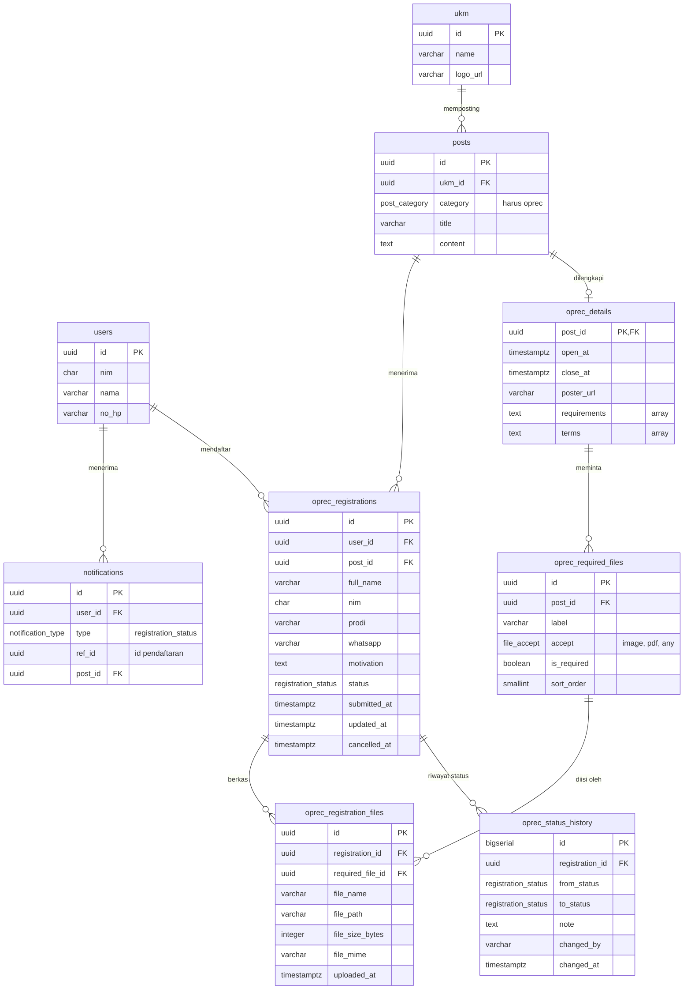

# Modul 3 Open Recruitment: API Contract & Database Design

Nov 5, 2026 · diperbarui Nov 6, 2026 · @Lutfi

Spesifikasi seluruh modul (ERD, DDL, dan 44 endpoint untuk aplikasi mobile dan website admin) ada di dokumen UKM Hub Unand: ERD & API Contract (Seluruh Modul). Bila ada perbedaan dengan dokumen ini, dokumen seluruh modul yang berlaku. Perubahan 6 Nov 2026 di bawah sudah dimasukkan ke kedua dokumen.

## Perubahan 6 Nov 2026

Disesuaikan dengan desain UI form pendaftaran dan detail oprec. Semua perubahan ini juga sudah tercatat di dokumen seluruh modul (DDL, ERD 3, endpoint 19 sampai 26, A5, A6, A12 sampai A14).

| Perubahan | Sebelumnya | Sekarang | Yang terdampak |
| --- | --- | --- | --- |
| Nomor WhatsApp | Tidak ada; hanya `users.no_hp` | Kolom `whatsapp` di `oprec_registrations`, diisi di form, salinan per pendaftaran | DDL, endpoint 3, 6, objek Registration |
| Berkas pendaftaran | Satu berkas per pendaftaran (`file_*` di `oprec_registrations`) | Slot berkas ditentukan admin per oprec (`oprec_required_files`); satu berkas per slot (`oprec_registration_files`) | DDL, endpoint 1 sampai 3, 6, 8, objek Registration, website admin A5 dan A14 |
| Syarat dan S&K | Ditulis di `posts.content` | Kolom daftar `requirements` dan `terms` di `oprec_details` | DDL, endpoint 1 dan 2, website admin A5 |
| Pesan 415 | "Berkas harus PDF, JPG, atau PNG." | "Jenis berkas tidak sesuai dengan yang diminta." (karena tiap slot punya jenis sendiri) | Kode error |

## Keputusan database

**Keputusan (opsi A): PostgreSQL di server, diakses lewat REST API. Flutter hanya bicara ke API, tidak pernah ke database langsung.** Ini sejalan dengan PRD (NFR-05: data lewat REST API, backend MySQL/PostgreSQL) dan Aturan Project 3c-3d (data terhubung ke server atau database lokal, tanpa Firebase untuk penyimpanan data).

| Opsi | Sesuai PRD dan aturan? | Usaha | Risiko utama |
| --- | --- | --- | --- |
| A. PostgreSQL + REST API buatan sendiri (Express) | Ya, persis seperti PRD | Tinggi: server, endpoint, upload berkas | Backend belum ada; Modul 3 baru bisa diuji penuh setelah backend jalan |
| B. Supabase (PostgreSQL hosted + REST otomatis + storage berkas) | Sebagian: databasenya PostgreSQL asli, tetapi layanannya BaaS seperti Firebase; aturan hanya menyebut Firebase | Rendah | Dosen bisa menilainya bukan backend sendiri; perlu konfirmasi |
| C. SQLite lokal saja (sqflite atau drift) | Memenuhi aturan 3c, tetapi bertentangan dengan PRD | Rendah | Admin tidak bisa mengubah status, jadi FR-12 dan FR-13 hanya simulasi |

Pilih **A**. Pilih B hanya bila dosen menyetujui. Pakai C hanya sebagai cadangan bila backend belum siap, karena skema di bagian berikut bisa dipakai apa adanya di SQLite.

**Kenapa PostgreSQL, bukan MySQL**

- Mendukung *partial unique index*, sehingga mahasiswa yang membatalkan pendaftaran boleh mendaftar lagi tanpa melanggar aturan satu pendaftaran per oprec (detail di bagian Desain database).
- Tipe `uuid`, `enum`, dan array (`text[]`) tersedia bawaan.
- PRD membolehkan keduanya. Bila tim sudah terbiasa dengan XAMPP dan MySQL, MySQL tetap bisa dipakai; aturan tadi cukup dipindah ke kode backend, dan kolom `text[]` diganti JSON.

**Penyimpanan berkas**: berkas pendaftaran disimpan di storage server (folder atau object storage). Database hanya menyimpan nama, ukuran, tipe, dan lokasinya, bukan isi berkas (BLOB); satu baris di `oprec_registration_files` untuk tiap berkas.

**Pertanyaan awal dan jawabannya**

1. Backend dibangun oleh partner (Express); website admin dibuat sendiri. Spesifikasi untuk partner ada di dokumen seluruh modul.
2. API dibuat sendiri oleh tim (opsi A), bukan disediakan dosen.
3. Supabase tidak dipakai.
4. Notifikasi: FCM tidak dipakai; diputuskan memakai foreground service dengan polling (lihat bagian Integrasi ke Flutter).

## Desain database

Modul 3 menambah empat tabel baru: `oprec_registrations`, `oprec_status_history`, `oprec_required_files` (diisi admin), dan `oprec_registration_files`. Modul 3 juga menambah dua kolom di `oprec_details`. Tabel lain dikelola admin atau dipakai bersama modul lain. Skema ditulis untuk PostgreSQL 13 ke atas.

ERD Modul 3 · 9 tabel. Tabel milik modul lain (`users`, `ukm`, `posts`, `notifications`) hanya ditulis kolom yang dipakai Modul 3; kolom lengkap ada di DDL.



Garis menunjukkan foreign key (kecuali `notifications.ref_id`, yang berupa rujukan tanpa constraint). Satu mahasiswa bisa punya banyak pendaftaran, satu postingan oprec menerima banyak pendaftaran dan punya beberapa slot berkas, tiap pendaftaran punya riwayat status sendiri, dan tiap pendaftaran punya paling banyak satu berkas per slot.

*(Diagram: siklus status pendaftaran · 6 status. Lihat tabel dan DDL di bawahnya.)*

Admin menggerakkan status ke kanan; mahasiswa hanya bisa membatalkan dan mengedit saat status masih Menunggu.

### Tabel milik Modul 3

**oprec_registrations**: satu baris per pendaftaran.

| Kolom | Tipe | Aturan | Padanan di kode |
| --- | --- | --- | --- |
| id | uuid | PK, dibuat otomatis | Registration.id |
| user_id | uuid | FK ke users, wajib | dari sesi login |
| post_id | uuid | FK ke posts, wajib; postingan harus berkategori oprec | Registration.postId |
| full_name | varchar(100) | wajib, 3 sampai 100 karakter | Registration.name |
| nim | char(10) | wajib, 10 digit angka | Registration.nim |
| prodi | varchar(100) | wajib, 2 sampai 100 karakter; diisi di form pendaftaran, bukan data akun | Registration.prodi |
| whatsapp | varchar(16) | wajib; `08...`, `628...`, atau `+628...`; 10 sampai 13 digit bila diawali 08 | Registration.whatsapp |
| motivation | text | wajib, 20 sampai 1000 karakter | Registration.motivation |
| status | enum registration_status | wajib, bawaan menunggu | Registration.status |
| submitted_at | timestamptz | wajib, bawaan waktu saat ini | Registration.createdAt |
| updated_at | timestamptz | wajib | Registration.updatedAt |
| cancelled_at | timestamptz | kosong, terisi saat dibatalkan | Registration.cancelledAt |

`full_name`, `nim`, dan `whatsapp` adalah salinan saat mendaftar, karena formulir memang mengizinkan mahasiswa mengisinya; ketiganya tidak ikut berubah bila profil diubah. Batas atas 100 dan 1000 karakter sudah disamakan di validator Flutter (`lib/utils/validators.dart`). Kolom `file_name`, `file_path`, `file_size_bytes`, dan `file_mime` dihapus dari tabel ini dan pindah ke `oprec_registration_files`.

**oprec_required_files**: slot berkas yang diminta satu oprec, diisi admin (mis. Pas Foto, KTM, CV). Form pendaftaran menampilkan satu slot unggah untuk tiap baris.

| Kolom | Tipe | Aturan | Padanan di kode |
| --- | --- | --- | --- |
| id | uuid | PK | RequiredFile.id |
| post_id | uuid | FK ke oprec_details, hapus berantai | |
| label | varchar(100) | wajib, mis. "Pas Foto" | RequiredFile.label |
| accept | enum file_accept | `image` (JPG/PNG), `pdf`, atau `any` (PDF/JPG/PNG) | RequiredFile.accept |
| is_required | boolean | bawaan true | RequiredFile.isRequired |
| sort_order | smallint | urutan tampil, bawaan 0 | urutan daftar |

Slot `image` dan `any` bisa diisi dari kamera di aplikasi; slot `pdf` hanya dari file picker.

**oprec_registration_files**: satu baris per berkas yang dikirim.

| Kolom | Tipe | Aturan | Padanan di kode |
| --- | --- | --- | --- |
| id | uuid | PK | id di `download_url` |
| registration_id | uuid | FK ke oprec_registrations, hapus berantai | |
| required_file_id | uuid | FK ke oprec_required_files; unik bersama registration_id | RegistrationFile.requiredFileId |
| file_name | varchar(255) | wajib | RegistrationFile.name |
| file_path | varchar(500) | wajib; lokasi di storage server, tidak dikirim ke klien | |
| file_size_bytes | integer | wajib, maksimal 2.097.152 (2 MB) | RegistrationFile.sizeBytes |
| file_mime | varchar(100) | application/pdf, image/jpeg, atau image/png, dan sesuai `accept` slotnya | RegistrationFile.mime |
| uploaded_at | timestamptz | wajib, bawaan waktu saat ini | |

**oprec_status_history**: satu baris setiap status berubah, termasuk saat pendaftaran dibuat. Dipakai untuk garis waktu status dan sebagai sumber notifikasi.

| Kolom | Tipe | Aturan | Padanan di kode |
| --- | --- | --- | --- |
| id | bigserial | PK | |
| registration_id | uuid | FK ke oprec_registrations, hapus berantai | |
| from_status | enum registration_status | kosong untuk baris pertama | StatusChange.fromStatus |
| to_status | enum registration_status | wajib | StatusChange.toStatus |
| note | text | opsional, mis. jadwal wawancara | StatusChange.note |
| changed_by | varchar(20) | mahasiswa atau admin | StatusChange.changedBy |
| changed_at | timestamptz | wajib, bawaan waktu saat ini | StatusChange.changedAt |

**Enum registration_status**: menunggu, seleksi, wawancara, diterima, ditolak, dibatalkan. Keenamnya sudah ada di enum `RegistrationStatus` di kode; nama enum sama dengan nilai di server, dan `RegistrationStatus.fromServer` memetakannya.

**Enum file_accept**: image, pdf, any. Padanannya `FileAccept` di kode.

### Tabel yang dipakai bersama

Modul 3 hanya membaca tabel ini, kecuali `notifications`.

| Tabel | Pemilik | Kolom yang dipakai Modul 3 |
| --- | --- | --- |
| users | autentikasi (tim) | id, nim, nama, email, no_hp, password_hash |
| ukm | admin backend | id, name, logo_url |
| posts | admin backend | id, ukm_id, category, title, content, published_at |
| oprec_details | admin backend, satu baris untuk tiap postingan berkategori oprec | post_id (PK dan FK), open_at, close_at, poster_url, **requirements**, **terms** (dua kolom baru, `text[]`) |
| notifications | dipakai bersama; Modul 3 mengisi type registration_status | id, user_id, type, title, body, ref_id, post_id, is_read, created_at |

Pemetaan ke model `OprecPost` di kode: id = posts.id, ukmName = ukm.name, logoUKM = ukm.logo_url, title = posts.title, description = posts.content, closeDate = oprec_details.close_at, posterAsset = oprec_details.poster_url, requirements = oprec_details.requirements, terms = oprec_details.terms, requiredFiles = baris `oprec_required_files` milik oprec itu (urut `sort_order`). `isClosed` dihitung dari close_at.

### Aturan bisnis

Poin 4 dan 7 adalah usulan; mohon dikonfirmasi tim.

1. Pendaftaran hanya bisa dibuat sebelum `close_at`, satu per mahasiswa per oprec yang masih aktif.
2. Edit dan pembatalan hanya boleh saat status masih `menunggu` dan sebelum `close_at` (PRD FR-11 menyebut "sebelum periode ditutup"). Sudah diputuskan.
3. Membatalkan tidak menghapus baris: status menjadi `dibatalkan`, `cancelled_at` terisi, dan riwayat tetap ada. Mahasiswa boleh mendaftar lagi karena aturan satu pendaftaran hanya berlaku untuk status selain `dibatalkan`.
4. Perubahan status hanya oleh admin. Setiap perubahan menambah satu baris di `oprec_status_history` dan satu baris di `notifications` dalam satu transaksi.
5. Hanya pemilik yang bisa membaca pendaftaran dan berkasnya (NFR-04).
6. Semua slot dengan `is_required = true` wajib terisi saat mendaftar. Tiap berkas maksimal 2 MB dan jenisnya harus sesuai `accept` slotnya. Berkas untuk slot yang bukan milik oprec itu ditolak (422).
7. Slot berkas yang sudah punya berkas pendaftar tidak bisa dihapus admin (foreign key tanpa hapus berantai menolaknya), dan `accept`-nya tidak bisa diubah; keduanya dijawab `409 SLOT_HAS_FILES`. Admin tetap boleh mengubah label dan urutan slot itu, atau menambah slot baru.

### DDL PostgreSQL

Kolom baru `oprec_details` ditulis sebagai `ALTER`, karena tabel itu didefinisikan di dokumen seluruh modul.

```sql
CREATE TYPE registration_status AS ENUM
  ('menunggu','seleksi','wawancara','diterima','ditolak','dibatalkan');
CREATE TYPE file_accept AS ENUM ('image','pdf','any');

ALTER TABLE oprec_details
  ADD COLUMN requirements text[] NOT NULL DEFAULT '{}',
  ADD COLUMN terms        text[] NOT NULL DEFAULT '{}';

CREATE TABLE oprec_required_files (
  id          uuid PRIMARY KEY DEFAULT gen_random_uuid(),
  post_id     uuid NOT NULL REFERENCES oprec_details(post_id) ON DELETE CASCADE,
  label       varchar(100) NOT NULL,
  accept      file_accept NOT NULL,
  is_required boolean NOT NULL DEFAULT true,
  sort_order  smallint NOT NULL DEFAULT 0
);
CREATE INDEX ix_required_files_post ON oprec_required_files (post_id, sort_order);

CREATE TABLE oprec_registrations (
  id              uuid PRIMARY KEY DEFAULT gen_random_uuid(),
  user_id         uuid NOT NULL REFERENCES users(id),
  post_id         uuid NOT NULL REFERENCES posts(id),
  full_name       varchar(100) NOT NULL CHECK (char_length(full_name) >= 3),
  nim             char(10) NOT NULL CHECK (nim ~ '^[0-9]{10}$'),
  prodi           varchar(100) NOT NULL CHECK (char_length(prodi) >= 2),
  whatsapp        varchar(16) NOT NULL CHECK (whatsapp ~ '^(\+62|62|0)8[0-9]{8,11}$'),
  motivation      text NOT NULL CHECK (char_length(motivation) BETWEEN 20 AND 1000),
  status          registration_status NOT NULL DEFAULT 'menunggu',
  submitted_at    timestamptz NOT NULL DEFAULT now(),
  updated_at      timestamptz NOT NULL DEFAULT now(),
  cancelled_at    timestamptz
);

CREATE UNIQUE INDEX uq_active_registration
  ON oprec_registrations (user_id, post_id) WHERE status <> 'dibatalkan';
CREATE INDEX ix_registrations_user ON oprec_registrations (user_id, submitted_at DESC);
CREATE INDEX ix_registrations_post ON oprec_registrations (post_id, status);

CREATE TABLE oprec_registration_files (
  id               uuid PRIMARY KEY DEFAULT gen_random_uuid(),
  registration_id  uuid NOT NULL REFERENCES oprec_registrations(id) ON DELETE CASCADE,
  required_file_id uuid NOT NULL REFERENCES oprec_required_files(id),
  file_name        varchar(255) NOT NULL,
  file_path        varchar(500) NOT NULL,
  file_size_bytes  integer NOT NULL CHECK (file_size_bytes <= 2097152),
  file_mime        varchar(100) NOT NULL
                   CHECK (file_mime IN ('application/pdf','image/jpeg','image/png')),
  uploaded_at      timestamptz NOT NULL DEFAULT now(),
  UNIQUE (registration_id, required_file_id)
);

CREATE TABLE oprec_status_history (
  id              bigserial PRIMARY KEY,
  registration_id uuid NOT NULL REFERENCES oprec_registrations(id) ON DELETE CASCADE,
  from_status     registration_status,
  to_status       registration_status NOT NULL,
  note            text,
  changed_by      varchar(20) NOT NULL CHECK (changed_by IN ('mahasiswa','admin')),
  changed_at      timestamptz NOT NULL DEFAULT now()
);
CREATE INDEX ix_history_registration ON oprec_status_history (registration_id, changed_at);
```

Kecocokan `file_mime` dengan `accept` slot tidak bisa dijadikan constraint dan harus diperiksa di kode backend.

## API contract

Modul 3 memakai 10 endpoint untuk aplikasi mobile dan 1 endpoint admin untuk mengubah status. Keempat operasi CRUD ada di data pendaftaran: Create (POST), Read (GET), Update (PATCH), Delete (DELETE, berupa pembatalan). Autentikasi (`POST /auth/login`) dimiliki modul autentikasi dan tidak diulang di sini.

### Konvensi

| Hal | Aturan |
| --- | --- |
| Base URL | `https://<host>/api/v1` (host belum ditentukan) |
| Autentikasi | Header `Authorization: Bearer <token>` pada semua endpoint |
| Format | JSON UTF-8, nama field snake_case. Create dan update pendaftaran memakai `multipart/form-data` karena membawa berkas |
| Ukuran request | Maksimal 2 MB per berkas. Batas body server minimal 2 MB × jumlah slot terbanyak ditambah sedikit ruang (mis. 12 MB untuk 5 slot) |
| Waktu | ISO 8601 UTC, mis. `2026-11-05T05:12:00Z`; aplikasi mengubahnya ke WIB saat ditampilkan |
| Respons sukses | `{"data": ..., "meta": {...}}`; `meta` hanya ada pada daftar: `page`, `limit`, `total` |
| Paginasi | `?page=1&limit=20` (bawaan 20, maksimal 50) |
| Respons error | `{"error": {"code": "...", "message": "...", "fields": {...}}}`. `message` berbahasa Indonesia dan aman ditampilkan langsung ke pengguna; `fields` hanya untuk 422 |
| Timeout klien | 15 detik (sudah ada di form pendaftaran) |

### Daftar endpoint

| No | Endpoint | Fungsi | Sukses |
| --- | --- | --- | --- |
| 1 | `GET /oprec` | Daftar oprec (filter `status=open/closed`, `ukm_id`) | 200 |
| 2 | `GET /oprec/{post_id}` | Detail satu oprec | 200 |
| 3 | `POST /oprec/{post_id}/registrations` | Create: mendaftar + upload berkas per slot | 201 |
| 4 | `GET /registrations` | Read: daftar pendaftaran milik sendiri | 200 |
| 5 | `GET /registrations/{id}` | Read: detail + riwayat status (dipakai untuk polling) | 200 |
| 6 | `PATCH /registrations/{id}` | Update: ubah data atau ganti berkas per slot | 200 |
| 7 | `DELETE /registrations/{id}` | Delete: batalkan pendaftaran | 204 |
| 8 | `GET /registrations/{id}/files/{file_id}` | Unduh satu berkas milik sendiri | 200 |
| 9 | `GET /notifications` | Daftar notifikasi (`type`, `unread`, `since`) | 200 |
| 10 | `PATCH /notifications/{id}/read` | Tandai notifikasi sudah dibaca | 200 |
| 11 | `PATCH /admin/registrations/{id}/status` | Admin mengubah status (bukan bagian aplikasi mobile) | 200 |

Bila Modul 1 sudah punya `GET /posts`, endpoint 1 dan 2 bisa menjadi filter `category=oprec` dari endpoint itu. Perlu disepakati dengan Aldo agar tidak ada dua endpoint untuk hal yang sama.

### Objek Registration

Dikembalikan oleh endpoint 3, 5, 6, dan 11. `can_modify` dihitung server (status `menunggu` dan sebelum `close_at`), dan dipakai Flutter untuk menampilkan tombol Edit dan Batal. `files` berisi satu item untuk tiap slot yang terisi; `label` disalin dari slotnya.

```json
{
  "id": "7c9e6679-7425-40de-944b-e07fc1f90ae7",
  "post_id": "b1f0c2a4-6d7e-4a3b-9c55-2f1e8d0a7b11",
  "full_name": "Nama Mahasiswa",
  "nim": "2411520000",
  "prodi": "Sistem Informasi",
  "whatsapp": "081234567890",
  "motivation": "Saya ingin belajar dan berkontribusi di UKM ini...",
  "status": "menunggu",
  "files": [
    {
      "id": "e5a1...",
      "required_file_id": "d2c4...",
      "label": "Pas Foto",
      "name": "foto.jpg",
      "size_bytes": 184320,
      "mime": "image/jpeg",
      "download_url": "/api/v1/registrations/7c9e6679-7425-40de-944b-e07fc1f90ae7/files/e5a1..."
    }
  ],
  "can_modify": true,
  "submitted_at": "2026-11-05T05:12:00Z",
  "updated_at": "2026-11-05T05:12:00Z",
  "cancelled_at": null
}
```

### 1. GET /oprec

```json
{
  "data": [{
    "id": "b1f0c2a4-6d7e-4a3b-9c55-2f1e8d0a7b11",
    "title": "Join AIESEC 2026",
    "description": "...",
    "ukm": { "id": "...", "name": "AIESEC in UNAND", "logo_url": "https://.../aiesec.png" },
    "open_at": "2026-10-20T00:00:00Z",
    "close_at": "2026-11-30T16:59:59Z",
    "poster_url": "https://.../poster.jpg",
    "requirements": ["Mahasiswa aktif Universitas Andalas", "Minimal semester 2"],
    "terms": ["Seluruh anggota wajib hadir tepat waktu dalam setiap agenda."],
    "required_files": [
      { "id": "d2c4...", "label": "Pas Foto", "accept": "image", "is_required": true },
      { "id": "f7b9...", "label": "CV", "accept": "pdf", "is_required": true }
    ],
    "is_closed": false,
    "my_registration": { "id": "7c9e6679-...", "status": "menunggu" }
  }],
  "meta": { "page": 1, "limit": 20, "total": 2 }
}
```

`my_registration` bernilai `null` bila mahasiswa belum mendaftar atau pendaftarannya sudah dibatalkan. `required_files` diurutkan menurut `sort_order`. Endpoint 2 mengembalikan satu objek dengan bentuk yang sama.

### 3. POST /oprec/{post_id}/registrations

Body `multipart/form-data`:

| Field | Aturan |
| --- | --- |
| full_name | wajib, 3 sampai 100 karakter |
| nim | wajib, tepat 10 digit angka |
| prodi | wajib, 2 sampai 100 karakter |
| whatsapp | wajib, `08...`, `628...`, atau `+628...`; 10 sampai 13 digit bila diawali 08 |
| motivation | wajib, 20 sampai 1000 karakter |
| `files[<required_file_id>]` | satu field per slot; wajib untuk slot `is_required`; jenis sesuai `accept`; maksimal 2 MB |

Contoh nama field berkas: `files[d2c4...]`. Sukses: `201 Created`, header `Location: /api/v1/registrations/{id}`, `data` berisi objek Registration. Server juga menulis baris pertama di `oprec_status_history` (kosong menjadi `menunggu`). Error yang mungkin: 401, 404, 409 `ALREADY_REGISTERED`, 409 `OPREC_CLOSED`, 413, 415, 422. Slot wajib yang kosong atau slot yang bukan milik oprec ini menghasilkan 422.

Contoh 422:

```json
{
  "error": {
    "code": "VALIDATION_ERROR",
    "message": "Data pendaftaran belum valid.",
    "fields": {
      "nim": "NIM harus 10 digit angka",
      "whatsapp": "Nomor WhatsApp tidak valid",
      "files[d2c4...]": "Berkas wajib diunggah"
    }
  }
}
```

### 4. GET /registrations

Query: `status` (opsional), `page`, `limit`. Urutan `submitted_at` terbaru lebih dulu. Setiap item adalah objek Registration ditambah `post` ringkas (`id`, `title`, `ukm_name`, `logo_url`, `close_at`).

### 5. GET /registrations/{id}

Objek Registration ditambah `post` dan `history`. Aplikasi memanggil endpoint ini setiap 30 detik selama halaman status terbuka, dan saat pull-to-refresh.

```json
{
  "data": {
    "id": "7c9e6679-...",
    "status": "seleksi",
    "post": { "id": "b1f0c2a4-...", "title": "Join AIESEC 2026", "ukm_name": "AIESEC in UNAND" },
    "history": [
      { "from_status": null, "to_status": "menunggu", "note": null,
        "changed_by": "mahasiswa", "changed_at": "2026-11-05T05:12:00Z" },
      { "from_status": "menunggu", "to_status": "seleksi", "note": null,
        "changed_by": "admin", "changed_at": "2026-11-07T02:00:00Z" }
    ]
  }
}
```

### 6. PATCH /registrations/{id}

`multipart/form-data`; semua field opsional (`full_name`, `nim`, `prodi`, `whatsapp`, `motivation`, `files[<required_file_id>]`) dengan aturan sama seperti endpoint 3. Berkas baru hanya menggantikan berkas di slot yang sama, dan berkas lama di slot itu dihapus dari storage; slot lain tidak berubah. Sukses: `200` dengan objek Registration. Error: 403, 404, 409 `REGISTRATION_LOCKED` (status bukan `menunggu`), 409 `OPREC_CLOSED`, 413, 415, 422.

### 7. DELETE /registrations/{id}

Sukses: `204 No Content`. Server mengubah status menjadi `dibatalkan`, mengisi `cancelled_at`, dan menambah baris riwayat (`menunggu` menjadi `dibatalkan`, `changed_by` = `mahasiswa`). Baris dan berkasnya tidak dihapus. Error: 403, 404, 409 `REGISTRATION_LOCKED` (status bukan menunggu), 409 `OPREC_CLOSED` (sudah lewat `close_at`). Server memeriksa `close_at` juga di endpoint ini, bukan hanya di POST dan PATCH. Bila dua syarat gagal sekaligus, kembalikan `REGISTRATION_LOCKED` lebih dulu. Endpoint ini tanpa body, jadi 413, 415, dan 422 tidak berlaku.

### 8. GET /registrations/{id}/files/{file_id}

Mengembalikan isi satu berkas dengan `Content-Type` dan `Content-Disposition` yang sesuai. Hanya pemilik yang boleh mengunduh (NFR-04); selain itu `403`. `file_id` yang bukan milik pendaftaran itu menghasilkan `404`. Karena butuh header token, berkas diunduh lewat HTTP client aplikasi, bukan `Image.network` biasa. Endpoint admin A14 berubah dengan pola yang sama.

### 9-10. Notifikasi

```json
{
  "data": [{
    "id": "a3d2...",
    "type": "registration_status",
    "title": "Status pendaftaran berubah",
    "body": "Pendaftaranmu di AIESEC in UNAND kini: Seleksi Berkas.",
    "ref_id": "7c9e6679-...",
    "post_id": "b1f0c2a4-...",
    "is_read": false,
    "created_at": "2026-11-07T02:00:00Z"
  }],
  "meta": { "page": 1, "limit": 20, "total": 1, "unread_count": 1 }
}
```

`PATCH /notifications/{id}/read` mengembalikan `200` dengan notifikasi yang `is_read`-nya `true`. Aman dipanggil berulang.

### 11. PATCH /admin/registrations/{id}/status

Body JSON: `{"status": "wawancara", "note": "Wawancara Senin 10 Nov 2026, pukul 14.00"}`. Untuk demo cukup dipanggil lewat Postman atau halaman admin sederhana, sesuai PRD bahwa verifikasi seleksi dilakukan admin lewat backend. Dalam satu transaksi server mengubah `status`, menambah baris `oprec_status_history`, dan menambah baris `notifications`.

Transisi yang diizinkan (usulan; lainnya `409 INVALID_TRANSITION`):

| Dari | Ke |
| --- | --- |
| menunggu | seleksi |
| seleksi | wawancara, ditolak |
| wawancara | diterima, ditolak |

### Yang berubah di website admin

A5 `POST /admin/posts` untuk `category=oprec` perlu menerima `requirements` dan `terms` (JSON array berbentuk teks, seperti `tags`) serta `required_files` (JSON array berisi `label`, `accept`, `is_required`; urutan array menjadi `sort_order`). Pada A6 `PATCH /admin/posts/{id}`, `required_files` menggantikan daftar slot: item dengan `id` mengubah slot itu, item tanpa `id` menambah slot, dan slot yang tidak ada di daftar dihapus (tunduk pada aturan bisnis 7). A12 dan A13 mengembalikan objek Registration lengkap dengan `whatsapp` dan `files`; A14 menjadi `GET /admin/registrations/{id}/files/{file_id}`. Halaman admin perlu form untuk mengisi daftar syarat, S&K, dan slot berkas.

### Kode error

| HTTP | code | Kapan | Pesan |
| --- | --- | --- | --- |
| 401 | UNAUTHENTICATED | Token tidak ada atau kedaluwarsa | Sesi berakhir, silakan login lagi. |
| 403 | FORBIDDEN | Mengakses data milik orang lain | Kamu tidak punya akses ke pendaftaran ini. |
| 404 | NOT_FOUND | Oprec, pendaftaran, berkas, atau notifikasi tidak ada | Data tidak ditemukan. |
| 409 | ALREADY_REGISTERED | Sudah punya pendaftaran aktif di oprec itu | Kamu sudah mendaftar di open recruitment ini. |
| 409 | OPREC_CLOSED | Mendaftar, mengubah, atau membatalkan pendaftaran setelah `close_at` | Pendaftaran sudah ditutup. |
| 409 | REGISTRATION_LOCKED | Edit atau batal saat status bukan `menunggu` | Pendaftaran tidak bisa diubah karena sudah diproses. |
| 409 | INVALID_TRANSITION | Admin memakai transisi yang tidak diizinkan | Perubahan status tidak valid. |
| 409 | SLOT_HAS_FILES | Admin menghapus slot berkas, atau mengubah `accept`-nya, padahal sudah ada berkas pendaftar di slot itu | Slot berkas tidak bisa diubah karena sudah ada pendaftar yang mengunggah. |
| 413 | FILE_TOO_LARGE | Salah satu berkas lebih dari 2 MB | Ukuran berkas maksimal 2 MB. |
| 415 | UNSUPPORTED_FILE_TYPE | Bukan PDF, JPG, atau PNG, atau tidak sesuai `accept` slotnya | Jenis berkas tidak sesuai dengan yang diminta. |
| 422 | VALIDATION_ERROR | Field tidak lolos validasi, slot wajib kosong, atau slot tidak dikenal | Data pendaftaran belum valid. |
| 500 | INTERNAL_ERROR | Kesalahan server | Terjadi kesalahan di server. Coba lagi nanti. |

Pesan 404, 409 (`ALREADY_REGISTERED`, `OPREC_CLOSED`, `REGISTRATION_LOCKED`), dan 422 sengaja sama dengan pesan di `FakeOprecRepository`, jadi tampilan error di aplikasi tidak berubah saat repository diganti. Kegagalan jaringan dan timeout tidak datang dari server; aplikasi memetakannya ke pesan yang sudah ada: "Tidak dapat terhubung ke server. Periksa koneksi internetmu."

## Integrasi ke Flutter

Beralih dari data palsu ke server cukup dengan mengganti satu implementasi `OprecRepository`; layar hanya tahu antarmukanya lewat `oprecRepositoryProvider`. Antarmuka di bawah sudah diterapkan (`lib/features/oprec/data/oprec_repository.dart`), dan `FakeOprecRepository` sudah menjalankan semua metodenya dengan aturan bisnis dan pesan error yang sama dengan API.

### Antarmuka repository

Berkas memakai `XFile`, karena file picker (`PlatformFile.xFile`) dan kamera (`image_picker`) sama-sama menghasilkan tipe ini.

```dart
abstract class OprecRepository {
  Future<List<OprecPost>> fetchOprecPosts({bool onlyOpen = false});     // GET /oprec
  Future<OprecPost> fetchOprecPost(String postId);                      // GET /oprec/{id}
  Future<Registration> submitRegistration({                            // POST
    required OprecPost post,
    required String name,
    required String nim,
    required String prodi,
    required String whatsapp,
    required String motivation,
    required Map<String, XFile> files,   // kunci: RequiredFile.id
  });
  Future<List<Registration>> fetchMyRegistrations();                    // GET /registrations
  Future<Registration> fetchRegistration(String id);                    // GET /registrations/{id}
  Future<Registration> updateRegistration(String id, {                 // PATCH
    String? name, String? nim, String? prodi, String? whatsapp,
    String? motivation, Map<String, XFile>? files,
  });
  Future<void> cancelRegistration(String id);                           // DELETE
}
```

`FakeOprecRepository` juga punya `simulateAdminStatusChange` sebagai pengganti endpoint 11 selama backend belum ada; metode ini bukan bagian antarmuka. Notifikasi memakai antarmuka terpisah (`fetchNotifications`, `markRead`) supaya bisa dipakai modul lain.

### Perubahan model

| Model | Perubahan | Status |
| --- | --- | --- |
| RegistrationStatus | Tambah `dibatalkan` (label Dibatalkan) dan `fromServer` | Selesai |
| Registration | Tambah `prodi`, `whatsapp`, `files`, `canModify`, `updatedAt`, `cancelledAt`, `history`, `fromJson`, `copyWith`; `fileName` diganti `files` | Selesai |
| StatusChange (baru) | Satu baris riwayat status, dengan `fromJson` | Selesai |
| RegistrationFile (baru) | Satu berkas terkirim per slot, dengan `fromJson` | Selesai |
| RequiredFile dan FileAccept (baru) | Slot berkas oprec dan jenis berkas yang diterima, dengan `fromJson` | Selesai |
| OprecPost | Tambah `requirements`, `requiredFiles`, `terms` | Selesai |
| OprecPost | Tambah `fromJson`; `posterAsset` (path aset) diganti `posterUrl` (URL jaringan), jadi `Image.asset` di layar detail menjadi `Image.network` | Tahap 5 (poster dummy masih aset) |
| Registration | Ringkasan `post` dari endpoint 4 dan 5 (judul, nama UKM, logo, `close_at`) | Tahap 2, untuk layar Pendaftaran Saya |

### Layar yang sudah sesuai desain UI

- **Detail oprec**: poster memenuhi bagian atas, sheet putih yang bisa ditarik (poster makin buram), logo dan nama UKM, deskripsi, tanggal tutup, kartu Syarat Pendaftaran, Berkas yang diunggah, dan Syarat dan Ketentuan Berlaku (maksimal 3 poin sebelum "lihat selengkapnya"), tombol biru DAFTAR SEKARANG.
- **Formulir pendaftaran**: Nama, NIM, Program Studi, No.WhatsApp, Motivasi, satu kartu unggah per slot berkas (tombol kamera untuk slot gambar, Pilih File untuk semua slot), tombol biru KONFIRMASI.

Hal di desain yang belum cocok dengan kontrak atau belum ada (perlu diperbarui di desain):

1. Field Program Studi belum ada di desain, padahal wajib; di aplikasi ditambahkan di bawah NIM.
2. "Berhasil terunggah!" memberi kesan berkas langsung dikirim saat dipilih, padahal semua berkas dikirim sekaligus saat KONFIRMASI. Aplikasi menulis "Siap dikirim", dan pesan merah untuk berkas yang tidak lolos pengecekan.
3. Judul postingan oprec tidak tampil di layar detail, hanya nama UKM.
4. Belum ada tampilan untuk oprec ditutup, sudah mendaftar, dan pendaftaran dibatalkan; aplikasi memakai tombol yang sama dengan label berbeda.
5. Layar detail tidak punya tombol kembali; aplikasi menambahkan tombol bulat di atas poster.
6. Thumbnail PDF di desain memperlihatkan isi halaman; aplikasi memakai ikon.
7. Bottom nav di desain berbeda dari yang sekarang, tetapi itu milik Modul 2 (`home_screen.dart`) dan tidak diubah.
8. Belum ada desain layar Pendaftaran Saya dan detail status.

### Tahapan pengerjaan

1. Sepakati kontrak ini dengan Aldo dan Farrel: endpoint bersama (`/posts`, `/notifications`) dan format token login.
2. Backend: jalankan DDL, isi data awal dua oprec yang sama dengan `kDummyOprecPosts` (AIESEC dan Neo Telemetri, lengkap dengan syarat, S&K, dan slot berkasnya), lalu bangun endpoint 1 sampai 7, disusul 8 sampai 11.
3. Flutter: tambah `dio` dan satu `ApiClient` (base URL, header token dari `StorageService`, pemetaan error server ke `RegistrationException`).
4. Tulis `RemoteOprecRepository` dan ganti isi `oprecRepositoryProvider` (satu baris). `FakeOprecRepository` dipertahankan untuk test.
5. Tambah layar baru: Pendaftaran Saya (daftar), detail status dengan garis waktu riwayat, edit, dan batal dengan dialog konfirmasi. Ini yang melengkapi CRUD dan FR-11.
6. Notifikasi (lihat di bawah).
7. Tambah test untuk pemetaan JSON dan pemetaan error; test integrasi yang ada tetap memakai repository palsu.

### Notifikasi tanpa Firebase

Aturan 3f mewajibkan notifikasi di tiap modul, dan FR-13 menyebut perubahan status pendaftaran. Rencana bawaan:

- Keputusan: foreground service di Android memanggil `GET /notifications?since=...` setiap 30 detik, termasuk saat aplikasi tertutup. Notifikasi baru ditampilkan lewat `flutter_local_notifications` dan menambah badge di tab Aktivitas (tab ke-3 bottom nav; isinya masih menunggu keputusan, lihat daftar di akhir dokumen).
- Service menampilkan satu notifikasi tetap di status bar, butuh izin notifikasi (Android 13 ke atas), dan bisa dimatikan sistem pada beberapa merek HP; untuk demo matikan optimasi baterai. Target NFR-06 (satu menit) terpenuhi. Syarat Android dan cara kerja lengkap ada di bagian Notifikasi dokumen seluruh modul.

### Catatan pengembangan

- Emulator Android mengakses laptop lewat `10.0.2.2`, bukan `localhost`. Pada perangkat fisik pakai IP laptop di jaringan yang sama.
- Android 9 ke atas memblokir HTTP polos; selama pengembangan aktifkan `usesCleartextTraffic` di `AndroidManifest.xml`, atau pakai HTTPS.
- Unggah berkas memakai `FormData`: satu `MultipartFile.fromFile(xFile.path)` per slot, dengan nama field `files[<required_file_id>]`. Target proyek ini Android, jadi `path` selalu terisi.
- Kamera memakai `image_picker` (intent kamera bawaan). Tidak perlu izin `CAMERA` di manifest selama aplikasi tidak mendeklarasikannya. Foto diperkecil (lebar maksimal 1600 px, kualitas 85) supaya muat di batas 2 MB.
- Di Android, `XFile.name` diambil dari nama path, bukan dari parameter `name`. Nama berkas yang tampil di form dan yang dikirim ke server sama-sama memakai `XFile.name`.

## Rencana pengerjaan Modul 3

Urutan yang disarankan, dari yang bisa dikerjakan sekarang tanpa menunggu backend sampai yang bergantung pada backend. Belum ada tanggal karena tenggat berikutnya belum diketahui.

| Tahap | Pekerjaan | Butuh backend? | Status (6 Nov 2026) |
| --- | --- | --- | --- |
| 1 | Tambah `dibatalkan` ke enum, perluas model dan `OprecRepository` sesuai bagian Integrasi | Tidak | Selesai, termasuk WhatsApp dan slot berkas dinamis |
| 2 | Layar Pendaftaran Saya, detail status dengan garis waktu, edit, dan batal (memakai `FakeOprecRepository` dulu) | Tidak | Sebagian: form dan detail oprec sudah sesuai desain; Pendaftaran Saya, garis waktu, edit, dan batal belum |
| 3 | Notifikasi lokal untuk perubahan status (dipicu `simulateAdminStatusChange` di repository palsu) | Tidak | Belum |
| 4 | Backend: DDL, data awal, endpoint 1 sampai 11 | Ini pekerjaannya | Belum |
| 5 | `ApiClient` dan `RemoteOprecRepository`, ganti provider | Ya | Belum |
| 6 | Polling status dan notifikasi dari server; uji alur penuh dengan admin mengubah status lewat Postman | Ya | Belum |
| 7 | Test, perbarui laporan dan AI Usage Log | Sebagian | Berjalan: 37 test, semuanya lulus |

Tahap 1 sampai 3 memenuhi CRUD lengkap, notifikasi, dan fitur perangkat (file picker dan kamera) di sisi aplikasi, sehingga Modul 3 tetap bisa didemokan bila backend terlambat.

### Perlu disepakati dengan tim

- [x] Backend dibangun oleh partner dengan Express; website admin dibuat sendiri. Spesifikasi untuk partner ada di dokumen seluruh modul.
- [x] API dibuat sendiri oleh tim (opsi A), bukan disediakan dosen.
- [x] Supabase tidak dipakai.
- [x] FCM tidak dipakai; notifikasi memakai foreground service.
- [x] `GET /oprec` dipertahankan, dan `GET /posts` juga mengembalikan data oprec (dokumen seluruh modul).
- [x] Edit dan batal pendaftaran hanya saat status `menunggu` (diputuskan).
- [x] Nomor WhatsApp disimpan per pendaftaran di kolom `whatsapp` (diputuskan 6 Nov 2026).
- [x] Slot berkas ditentukan admin per oprec (diputuskan 6 Nov 2026).
- [x] Syarat dan S&K disimpan sebagai daftar di `oprec_details` (diputuskan 6 Nov 2026).
- [x] Perubahan 6 Nov 2026 dimasukkan ke dokumen seluruh modul (DDL, ERD 3, endpoint 19 sampai 26, A5, A6, A12 sampai A14).
- [x] Dokumen di claude.ai diperbarui mengikuti `docs/`, termasuk menggambar ulang diagram ERD (selesai 6 Nov 2026).
- [ ] Partner backend menyetujui format field berkas `files[<required_file_id>]` dan batas ukuran request.
- [ ] Isi tab ke-3 bottom nav: Pendaftaran Saya atau daftar oprec. Perubahannya menyentuh `home_screen.dart` milik Modul 2.
- [ ] Desain diperbarui: field Program Studi, judul oprec di detail, keadaan tombol (ditutup, sudah mendaftar, dibatalkan), dan layar Pendaftaran Saya.
- [ ] Format token login dari modul autentikasi (usulan di dokumen seluruh modul: JWT Bearer, berlaku 7 hari).
- [ ] Tempat menjalankan backend saat demo: laptop partner di jaringan yang sama, atau hosting.